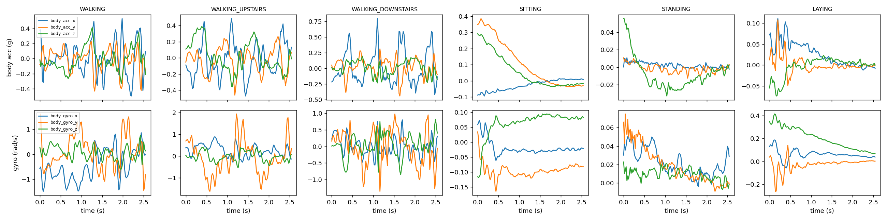
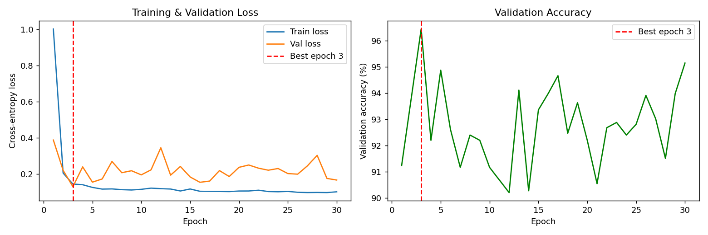
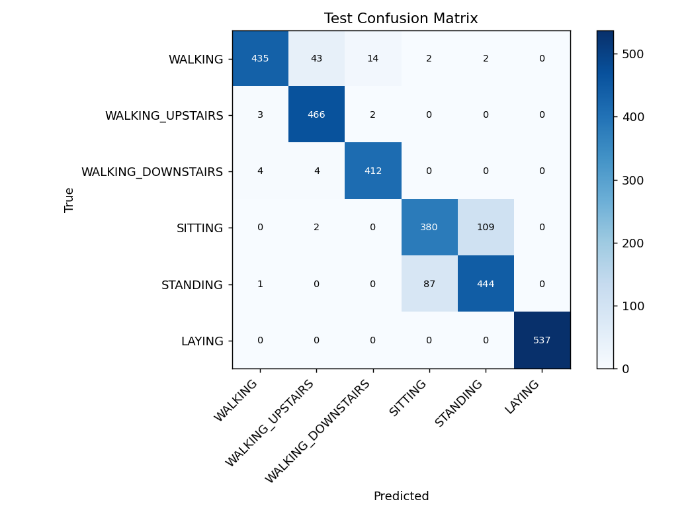
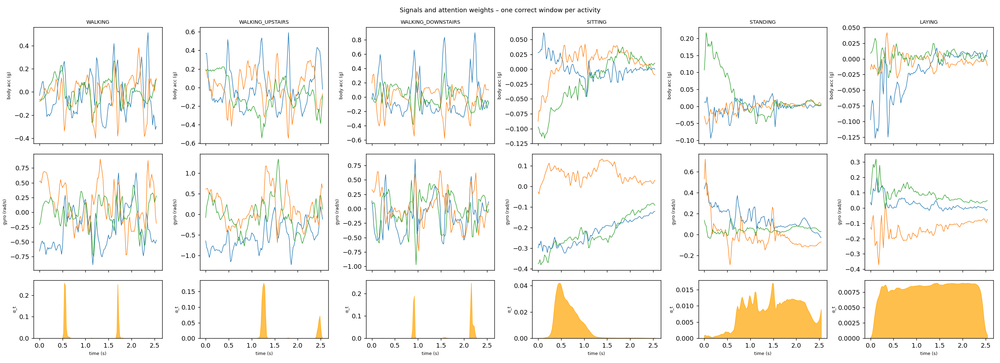
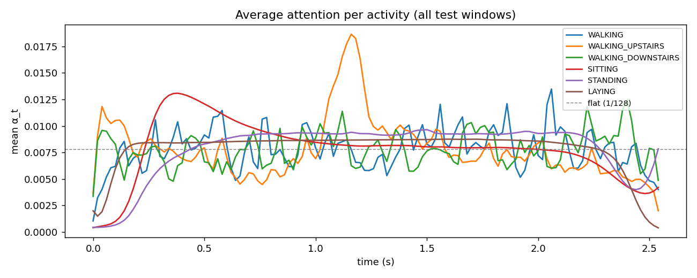
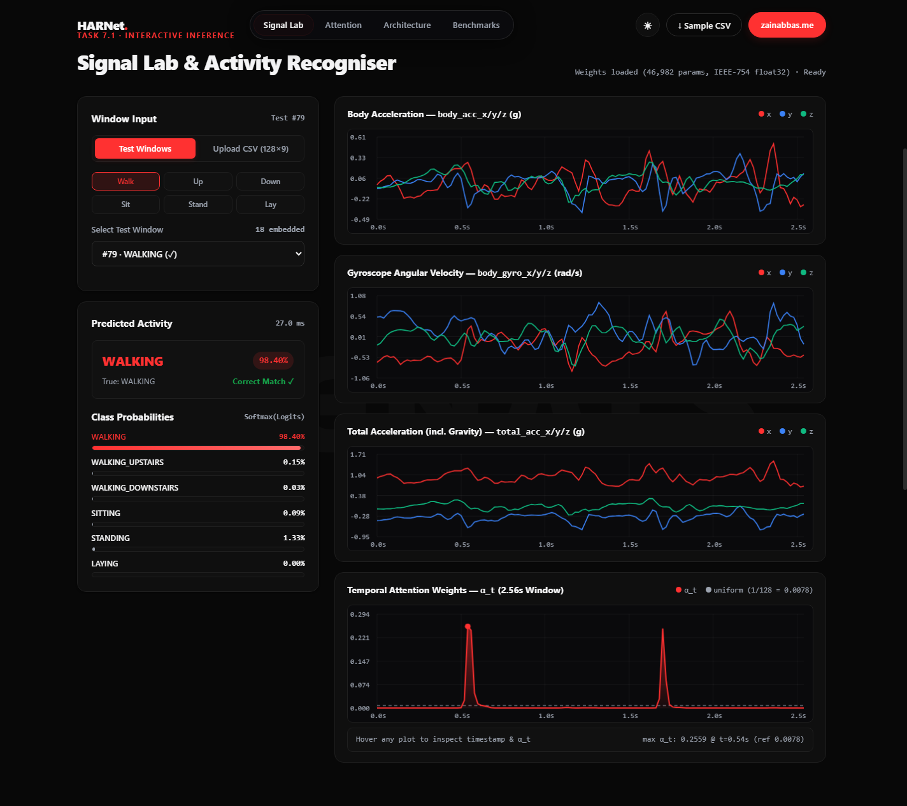

# Recognizing Human Activity from Phone Motion Sensors
### Hand-Coded RNN, LSTM, BiLSTM & Temporal Attention From Scratch in PyTorch

[](https://www.python.org/)
[](https://pytorch.org/)
[]()
[]()
[-critical.svg)]()
[](https://www.zainabbas.me/)

---

## Table of Contents

1. [Executive Summary & Problem Statement](#1-executive-summary--problem-statement)
2. [The Core Question: Where Does the Model Look?](#2-the-core-question-where-does-the-model-look)
3. [Mathematical Foundations & Derivations](#3-mathematical-foundations--derivations)
   - [3.1 Plain RNN Cell (`RNNCell`)](#31-plain-rnn-cell-rnncell)
   - [3.2 Packed 4-Gate LSTM Cell (`LSTMCell`)](#32-packed-4-gate-lstm-cell-lstmcell)
   - [3.3 Sequence Unrolling & Bidirectional Concatenation (`LSTM`, `BiLSTM`)](#33-sequence-unrolling--bidirectional-concatenation-lstm-bilstm)
   - [3.4 Additive Temporal Attention (`Attention`)](#34-additive-temporal-attention-attention)
   - [3.5 Full `HARNet` Topology & Parameter Count Derivation](#35-full-harnet-topology--parameter-count-derivation)
   - [3.6 Uniform Weight Initialisation & Initial Loss Sanity Check](#36-uniform-weight-initialisation--initial-loss-sanity-check)
   - [3.7 Training Protocol & Gradient Norm Clipping](#37-training-protocol--gradient-norm-clipping)
4. [Strict Library Compliance Audit](#4-strict-library-compliance-audit)
5. [Dataset & Person-Based Split Protocol](#5-dataset--person-based-split-protocol)
6. [Repository Structure](#6-repository-structure)
7. [Step-by-Step Reproduction Guide](#7-step-by-step-reproduction-guide)
8. [Experimental Results & Tables](#8-experimental-results--tables)
   - [Table 1 – Data](#table-1--data)
   - [Table 2 – Network and Training](#table-2--network-and-training)
   - [Table 3 – Test Results](#table-3--test-results)
   - [6×6 Test Confusion Matrix](#66-test-confusion-matrix)
   - [Correctness Checks](#correctness-checks)
9. [Figures & Visualisations Gallery](#9-figures--visualisations-gallery)
10. [Task 6 – Comprehensive Analysis Answers](#10-task-6--comprehensive-analysis-answers)
11. [Standalone Browser Application (`app/index.html`)](#11-standalone-browser-application-appindexhtml)
12. [Deliverables & Team Contributions](#12-deliverables--team-contributions)

---

## 1. Executive Summary & Problem Statement

Modern smartphones and wearables continuously sample inertial measurement units (IMUs) — a triaxial accelerometer and a triaxial gyroscope — to infer physical movement. Rather than relying on hand-engineered frequency/statistical features (`X_train.txt`, `X_test.txt`), this project classifies human activities directly from raw multivariate sensor time series using recurrent architectures written from scratch in PyTorch.

### Input & Output Formalism
- **Input ($X$):** One $2.56\text{-second}$ sliding window sampled at $50\text{ Hz}$, forming a tensor of shape $(128, 9)$ across $9$ inertial signal channels:
  1. `body_acc_x`, `body_acc_y`, `body_acc_z` — body linear acceleration with gravity removed ($g$)
  2. `body_gyro_x`, `body_gyro_y`, `body_gyro_z` — angular velocity from the gyroscope ($\text{rad/s}$)
  3. `total_acc_x`, `total_acc_y`, `total_acc_z` — raw accelerometer reading including gravity ($g$)
- **Output ($y$):** One of $6$ activity classes (re-indexed from $1\text{–}6$ to $0\text{–}5$):
  `0: WALKING`, `1: WALKING_UPSTAIRS`, `2: WALKING_DOWNSTAIRS`, `3: SITTING`, `4: STANDING`, `5: LAYING`.

---

## 2. The Core Question: Where Does the Model Look?

> **"When the network decides what someone is doing, which moments of the 2.56-second window does it pay attention to, and which activities can it not tell apart?"**

Using additive attention weights $\alpha_t \in (0, 1)$ with $\sum_{t=1}^{128} \alpha_t = 1$ (uniform baseline $1/128 \approx 0.0078$), our trained **HARNet** reveals two clear behaviours on the $2,947$ held-out test windows:
1. **Peaked attention on moving activities vs. flat attention on still postures:** During `WALKING` ($\overline{\max \alpha_t} = 0.2863$), `WALKING_DOWNSTAIRS` ($0.2640$), and `WALKING_UPSTAIRS` ($0.2174$), attention spikes sharply onto specific step-impact instants in the gait cycle. During `SITTING` ($0.0166$), `STANDING` ($0.0162$), and `LAYING` ($0.0104$), the signal is nearly constant across the window, so attention distributes almost uniformly.
2. **Confusion pair (`SITTING` ↔ `STANDING`) vs. perfect `LAYING`:** Nearly all misclassifications occur between `SITTING` and `STANDING` ($109$ `SITTING` predicted as `STANDING`; $87$ `STANDING` predicted as `SITTING`), whereas `LAYING` achieves **$100.00\%$ ($537/537$)** due to gravity re-orienting onto a distinct accelerometer axis.

---

## 3. Mathematical Foundations & Derivations

Let $x_t \in \mathbb{R}^D$ ($D = 9$) be the standardised sensor vector at time step $t \in \{1, \dots, 128\}$, and $h_t \in \mathbb{R}^H$ ($H = 64$) be the hidden state, initialised with $h_0 = \mathbf{0}$ and $c_0 = \mathbf{0}$.

### 3.1 Plain RNN Cell (`RNNCell`)
Implemented in [`src/layers.py`](src/layers.py) as the Task 6.6 baseline comparison cell:
$$h_t = \tanh(W x_t + U h_{t-1} + b), \qquad W \in \mathbb{R}^{H \times D}, \; U \in \mathbb{R}^{H \times H}, \; b \in \mathbb{R}^H$$

### 3.2 Packed 4-Gate LSTM Cell (`LSTMCell`)
All four gates are stored in one packed input matrix $W \in \mathbb{R}^{4H \times D}$, one recurrent matrix $U \in \mathbb{R}^{4H \times H}$, and one bias vector $b \in \mathbb{R}^{4H}$ in the order $[i, f, g, o]$:
$$z_t = x_t W^\top + h_{t-1} U^\top + b \in \mathbb{R}^{B \times 4H}$$
Splitting $z_t$ into four contiguous blocks of size $H$:
$$\begin{aligned}
i_t &= \sigma(W_i x_t + U_i h_{t-1} + b_i) && \text{(input gate)} \\
f_t &= \sigma(W_f x_t + U_f h_{t-1} + b_f) && \text{(forget gate)} \\
g_t &= \tanh(W_g x_t + U_g h_{t-1} + b_g) && \text{(cell candidate)} \\
o_t &= \sigma(W_o x_t + U_o h_{t-1} + b_o) && \text{(output gate)} \\
c_t &= f_t \odot c_{t-1} + i_t \odot g_t && \text{(cell state update)} \\
h_t &= o_t \odot \tanh(c_t) && \text{(hidden state)}
\end{aligned}$$

### 3.3 Sequence Unrolling & Bidirectional Concatenation (`LSTM`, `BiLSTM`)
- **`LSTM`:** Iterates `LSTMCell` over $t = 1, \dots, 128$ and stacks all hidden states to shape $(B, 128, H)$.
- **`BiLSTM`:** Runs two independent `LSTM` layers with separate weights:
  - Forward layer reads $(x_1, \dots, x_{128}) \to (\overrightarrow{h}_1, \dots, \overrightarrow{h}_{128})$.
  - Backward layer reads reversed input $(x_{128}, \dots, x_1)$ and reverses its outputs back into original time order $(\overleftarrow{h}_1, \dots, \overleftarrow{h}_{128})$.
  - Concatenation at every step yields $h_t = [\overrightarrow{h}_t \,;\, \overleftarrow{h}_t] \in \mathbb{R}^{2H}$, output shape $(B, 128, 128)$.

### 3.4 Additive Temporal Attention (`Attention`)
With parameters $W_a \in \mathbb{R}^{64 \times 2H}$, $b_a \in \mathbb{R}^{64}$, and $v \in \mathbb{R}^{64}$:
$$e_t = v^\top \tanh(W_a h_t + b_a), \qquad \alpha_t = \frac{\exp(e_t)}{\sum_{s=1}^{128} \exp(e_s)}, \qquad c = \sum_{t=1}^{128} \alpha_t h_t$$
Returning context $c \in \mathbb{R}^{B \times 128}$ and attention weights $\alpha \in \mathbb{R}^{B \times 128}$.

### 3.5 Full `HARNet` Topology & Parameter Count Derivation
Defined in [`src/model.py`](src/model.py): `BiLSTM(9, 64)` $\to$ `Attention(64, 64)` $\to$ `nn.Linear(128, 6)`:

| Component | Parameter Shapes | Exact Calculation | Trainable Params |
|---|---|---|---:|
| **Forward `LSTMCell`** | $W \in \mathbb{R}^{256 \times 9},\; U \in \mathbb{R}^{256 \times 64},\; b \in \mathbb{R}^{256}$ | $2304 + 16384 + 256$ | $18,944$ |
| **Backward `LSTMCell`** | $W \in \mathbb{R}^{256 \times 9},\; U \in \mathbb{R}^{256 \times 64},\; b \in \mathbb{R}^{256}$ | $2304 + 16384 + 256$ | $18,944$ |
| **Additive `Attention`** | $W_a \in \mathbb{R}^{64 \times 128},\; b_a \in \mathbb{R}^{64},\; v \in \mathbb{R}^{64}$ | $8192 + 64 + 64$ | $8,320$ |
| **Classifier `nn.Linear(128, 6)`** | $W_c \in \mathbb{R}^{6 \times 128},\; b_c \in \mathbb{R}^{6}$ | $768 + 6$ | $774$ |
| **Total (`HARNet`)** | | $37,888 + 8,320 + 774$ | **$46,982$** |

### 3.6 Uniform Weight Initialisation & Initial Loss Sanity Check
With `torch.manual_seed(0)` before instantiating `HARNet`, every recurrent and attention weight/bias tensor is initialised uniformly in $[-1/\sqrt{H}, 1/\sqrt{H}] = [-0.125, +0.125]$. At initialisation, all $6$ classes are approximately equiprobable:
$$\mathbb{E}[\mathcal{L}_{\text{init}}] \approx \ln(6) \approx \mathbf{1.7918}$$
Our measured initial training cross-entropy loss before step 1 was **$1.8058$**.

### 3.7 Training Protocol & Gradient Norm Clipping
Implemented in [`src/train.py`](src/train.py) with the exact required hyperparameters:
- **Loss:** `F.cross_entropy`
- **Optimiser:** `torch.optim.Adam(lr=1e-3)`
- **Batch size:** $64$, shuffled at every epoch
- **Epochs:** $30$
- **Gradient clipping:** `torch.nn.utils.clip_grad_norm_(model.parameters(), 1.0)` after `loss.backward()` and before `optimizer.step()`
- **Model selection:** Checkpoint saved from the epoch with the lowest validation loss (`Epoch 3`)

---

## 4. Strict Library Compliance Audit

Every source file under `src/` was audited against the allowed/forbidden library rules:

| Library / API | Status | Usage in Repository |
|:---|:---:|:---|
| `torch` tensors & autograd | Allowed | Core forward/backward computation |
| `nn.Module`, `nn.Parameter`, `nn.Linear` | Allowed | Custom cells, attention, and final $(128 \to 6)$ head |
| `torch.sigmoid`, `torch.tanh`, `torch.softmax` | Allowed | Gate nonlinearities and attention normalisation |
| `F.cross_entropy` | Allowed | Training and validation loss |
| `torch.optim.Adam`, `clip_grad_norm_` | Allowed | Parameter optimisation and gradient norm clipping |
| `numpy`, `matplotlib` | Allowed | Data preparation, custom metrics, and figures |
| `nn.RNN`, `nn.LSTM`, `nn.GRU` | **FORBIDDEN** | **0 occurrences** |
| `nn.RNNCell`, `nn.LSTMCell`, `nn.GRUCell` | **FORBIDDEN** | **0 occurrences** |
| `nn.MultiheadAttention`, `F.scaled_dot_product_attention` | **FORBIDDEN** | **0 occurrences** |
| `scikit-learn`, `Keras`, `TensorFlow` | **FORBIDDEN** | **0 occurrences** |

---

## 5. Dataset & Person-Based Split Protocol

Download the raw UCI HAR dataset (`human+activity+recognition+using+smartphones`, 58.2 MB, CC BY 4.0) from [UCI Machine Learning Repository](https://archive.ics.uci.edu/dataset/240/human+activity+recognition+using+smartphones) and extract into `data/` (excluded via `.gitignore`).

In [`src/prepare.py`](src/prepare.py):
1. Labels are shifted from `1–6` to `0–5`.
2. **Person-based validation split** prevents 50%-overlap window leakage between training and validation:
   ```python
   VAL_SUBJECTS = [3, 15, 25, 30]
   is_val = np.isin(train["subject"], VAL_SUBJECTS)
   ```
3. **Channel standardisation:** Per-channel mean $\mu_c$ and standard deviation $\sigma_c$ are computed across all time steps of the **training windows only**, then applied identically to training, validation, and test splits.
4. Signals are cast to `torch.float32` of shape $(N, 128, 9)$ and labels to `torch.long`.

---

## 6. Repository Structure

```text
├── data/                         # Unzipped UCI HAR dataset (ignored in git)
├── src/
│   ├── load_data.py              # Given raw signal loader (Appendix A.3)
│   ├── plot_windows.py           # Given example window plotter (Appendix A.4)
│   ├── prepare.py                # Task 1: label shift, person split, z-score, tensors
│   ├── layers.py                 # Task 2: RNNCell, LSTMCell, LSTM, BiLSTM, Attention
│   ├── model.py                  # Task 2.6: HARNet + parameter count verification
│   ├── train.py                  # Task 3: 30-epoch training, clip_grad_norm_, curves
│   ├── metrics.py                # Task 4.2: accuracy, confusion_matrix, per_class_accuracy
│   └── test_model.py             # Tasks 4 & 5: test evaluation, attention plots, analysis.md
├── results/
│   ├── best_model.pt             # Checkpoint from best validation epoch (Epoch 3)
│   ├── ch_mean.npy / ch_std.npy  # Training channel mean & std arrays
│   ├── training_history.npy      # Recorded epoch losses, accuracy, hardware & timing
│   ├── example_windows.png       # Figure 1: One example window per activity
│   ├── training_curves.png       # Figure 2: Loss & validation accuracy vs epoch
│   ├── confusion_matrix.png      # Figure 3: 6×6 test confusion matrix heat-map
│   ├── attention_per_window.png  # Figure 4: Signals + α_t for one correct window/activity
│   ├── average_attention.png     # Figure 5: Mean α_t curve per activity
│   ├── frontend_screenshot.png   # Figure 6: Standalone browser UI screenshot
│   ├── analysis.md               # Tables 1–3, Task 1.3 notes, Task 6 answers
│   ├── medium_blog.md            # Task 7.2: Medium blog draft (800–1500 words)
│   └── linkedin_post.md          # Task 7.3: LinkedIn post draft
├── app/
│   └── index.html                # Task 7.1: Single-file standalone browser app (zainabbas.me UI)
├── .gitignore                    # Excludes data/ and Python caches
├── requirements.txt              # torch, numpy, matplotlib
└── README.md                     # Project documentation and reproduction guide
```

---

## 7. Step-by-Step Reproduction Guide

Run all commands from the repository root (`AML_Assign-4/`):

### 1. Install Dependencies
```bash
pip install -r requirements.txt
```

### 2. Verify Data Loading & Example Windows (Tasks 1.1–1.3)
```bash
python src/load_data.py
python src/plot_windows.py
python src/prepare.py
```

### 3. Verify Hand-Coded Model & Metric Functions (Tasks 2 & 4.2)
```bash
python src/model.py
python src/metrics.py
```

### 4. Train `HARNet` (Task 3)
```bash
python src/train.py
```

### 5. Evaluate on Test Set & Generate Attention Plots (Tasks 4 & 5)
```bash
python src/test_model.py
```

### 6. Launch the Interactive Front End (Task 7.1)
Simply open [`app/index.html`](app/index.html) directly in any browser (Chrome, Edge, Firefox, Safari) — no server required.

---

## 8. Experimental Results & Tables

### Table 1 – Data

| Split | Windows | Volunteers | Subject IDs |
|---|---:|---:|---|
| **Train** | 5,891 | 17 | `1, 5, 6, 7, 8, 11, 14, 16, 17, 19, 21, 22, 23, 26, 27, 28, 29` |
| **Validation** | 1,461 | 4 | `3, 15, 25, 30` |
| **Test** | 2,947 | 9 | `2, 4, 9, 10, 12, 13, 18, 20, 24` |

**Training Channel Means & Standard Deviations:**

| Channel | Mean | Std Dev |
|---|---:|---:|
| `body_acc_x` | -0.000702 | 0.198904 |
| `body_acc_y` | -0.000268 | 0.122580 |
| `body_acc_z` | -0.000322 | 0.108991 |
| `body_gyro_x` | -0.000759 | 0.401472 |
| `body_gyro_y` | -0.000765 | 0.389227 |
| `body_gyro_z` | -0.000292 | 0.265129 |
| `total_acc_x` | 0.799970 | 0.419442 |
| `total_acc_y` | 0.020705 | 0.383104 |
| `total_acc_z` | 0.076466 | 0.376729 |

### Table 2 – Network and Training

| Metric | Value |
|---|---|
| Trainable parameters | **46,982** |
| Initial loss (before training) | **1.8058** (reference $\ln 6 \approx 1.7918$) |
| Best epoch (lowest validation loss) | **Epoch 3** |
| Training loss at best epoch | **0.1451** |
| Validation loss at best epoch | **0.1304** |
| Validation accuracy at best epoch | **96.44%** |
| Training time & hardware | **495.8s** on CPU (`Intel64 Family 6 Model 158 Stepping 13`) |

### Table 3 – Test Results

| Metric | Walk | Up | Down | Sit | Stand | Lay |
|---|---:|---:|---:|---:|---:|---:|
| **Per-class accuracy** | 87.70% | 98.94% | 98.10% | 77.39% | 83.46% | **100.00%** |
| **Mean of max $\alpha_t$** | 0.2863 | 0.2174 | 0.2640 | 0.0166 | 0.0162 | 0.0104 |

- **Overall Test Accuracy:** **$90.74\%$** ($2,674 / 2,947$ windows; uniform attention reference $1/128 \approx 0.0078$)

### 6×6 Test Confusion Matrix

Rows = true activity, columns = predicted activity:

| True \ Pred | WALKING | WALKING_UPSTAIRS | WALKING_DOWNSTAIRS | SITTING | STANDING | LAYING | Row Total |
|---|---:|---:|---:|---:|---:|---:|---:|
| **WALKING** | **435** | 43 | 14 | 2 | 2 | 0 | 496 |
| **WALKING_UPSTAIRS** | 3 | **466** | 2 | 0 | 0 | 0 | 471 |
| **WALKING_DOWNSTAIRS** | 4 | 4 | **412** | 0 | 0 | 0 | 420 |
| **SITTING** | 0 | 2 | 0 | **380** | 109 | 0 | 491 |
| **STANDING** | 1 | 0 | 0 | 87 | **444** | 0 | 532 |
| **LAYING** | 0 | 0 | 0 | 0 | 0 | **537** | 537 |

### Correctness Checks

- `LSTM` returns `(B, 128, 64)` and `BiLSTM` returns `(B, 128, 128)` — **Verified**
- `HARNet` contains exactly `46,982` trainable parameters — **Verified**
- Freshly initialised loss is `1.8058` ($\approx \ln 6 = 1.7918$) — **Verified**
- Attention weights $\alpha_t > 0$ and $\sum_{t=1}^{128} \alpha_t = 1$ for every test window — **Verified**
- Zero volunteer overlap across train (`17`), validation (`4`), and test (`9`) — **Verified**
- Confusion matrix entries sum to `2,947`, and every row matches its activity test count — **Verified**
- Test windows were never used during training, standardisation, or checkpoint selection — **Verified**

---

## 9. Figures & Visualisations Gallery

### Figure 1 — One Example Window per Activity (Task 1.3)

*Moving activities (`WALKING`, `WALKING_UPSTAIRS`, `WALKING_DOWNSTAIRS`) show strong periodic oscillations in both body acceleration and gyroscope signals driven by footsteps and torso rotation, whereas still activities (`SITTING`, `STANDING`, `LAYING`) remain nearly flat near zero.*

### Figure 2 — Training & Validation Curves (Task 3.2)


### Figure 3 — Test Confusion Matrix Heat-Map (Task 4.3)


### Figure 4 — Attention Over One Correct Window per Activity (Task 5.1)


### Figure 5 — Average Attention per Activity Across All Test Windows (Task 5.2)


### Figure 6 — Standalone Browser Front End (`app/index.html`, Task 7.1)


---

## 10. Task 6 – Comprehensive Analysis Answers

Full answers are also stored in [`results/analysis.md`](results/analysis.md):

1. **6.1 Why split validation by person rather than random windows?**
   Adjacent windows overlap by $50\%$ ($64$ shared samples). Random splitting leaks overlapping stride segments between training and validation, inflating validation accuracy via memorisation. Splitting by volunteer (`VAL_SUBJECTS = [3, 15, 25, 30]`) forces the model to generalise to unseen people.
2. **6.2 Which two activities are confused most often, and why?**
   `SITTING` and `STANDING` ($109 + 87 = 196$ errors out of $273$ total test errors). Both show near-zero body acceleration and angular velocity from a waist-worn phone, differing mainly by slight pelvis tilt in gravity.
3. **6.3 Why is `LAYING` recognised with $100.00\%$ accuracy?**
   Lying down rotates the phone so gravity aligns along a horizontal axis instead of the upright vertical axis, producing a distinct constant offset in `total_acc_x/y/z` unlike any upright posture.
4. **6.4 Is attention more peaked for moving or still activities?**
   Significantly more peaked for moving activities (`mean max α_t = 0.2174–0.2863`), where the model focuses on sharp step-impact moments. Still activities stay close to flat (`0.0104–0.0166` vs. uniform `0.0078`) because every time step is nearly identical.
5. **6.5 Why is BiLSTM allowed here, and when would it not be?**
   Allowed because classification operates offline on a complete, pre-recorded $2.56\text{-second}$ window where all $128$ steps are already available. It would not be allowed in real-time streaming inference (e.g., instant fall detection with zero look-ahead) where future samples do not exist yet.
6. **6.6 Why does an LSTM retain information over 128 steps better than a plain RNN, and what does gradient clipping guard against?**
   A plain RNN repeatedly multiplies gradients by $\tanh$ Jacobians ($\le 1$), causing exponential vanishing over $128$ steps. The LSTM additive cell update $c_t = f_t \odot c_{t-1} + i_t \odot g_t$ creates a near-unattenuated gradient highway when $f_t \approx 1$. Gradient clipping (`clip_grad_norm_` at `1.0`) guards against the opposite instability—exploding gradients—by rescaling oversized gradient vectors before stepping.

---

## 11. Standalone Browser Application (`app/index.html`)

[`app/index.html`](app/index.html) is a **single-file, zero-backend browser app** styled after [zainabbas.me](https://www.zainabbas.me/) (monochrome dark/light surface with `#ff3131` crimson accents, floating spotlight pill navbar, and `Space Grotesk` / `JetBrains Mono` typography).

- **Client-side PyTorch equivalence:** Embeds all $46,982$ trained IEEE-754 `float32` weights (`best_model.pt`) and training normalisation statistics in Base64, executing the exact `BiLSTM + Attention + Linear` forward pass in pure JavaScript (verified against PyTorch across all 18 embedded test samples with max probability difference $5.16 \times 10^{-7}$).
- **Interactive features:**
  - Pick from 18 embedded test windows grouped by activity, or upload any custom `128 × 9` CSV file (plus 1-click **Sample CSV** download).
  - Real-time Canvas plots of all 9 channels (`body_acc`, `body_gyro`, `total_acc`) and attention weights $\alpha_t$ with uniform $1/128$ reference line and hover timestamp inspector.
  - 6-class softmax probability bar chart and live forward-pass telemetry.

---

## 12. Deliverables & Team Contributions

- **Medium Blog Draft (800–1500 words):** [`results/medium_blog.md`](results/medium_blog.md)
- **LinkedIn Post Draft:** [`results/linkedin_post.md`](results/linkedin_post.md)
- **Links:**
  - GitHub Repository: https://github.com/F236108/Human-Activity-Recognition-from-Phone-Motion
  - Medium Blog: `<add-medium-link>`
  - LinkedIn Post: `<add-linkedin-link>`
