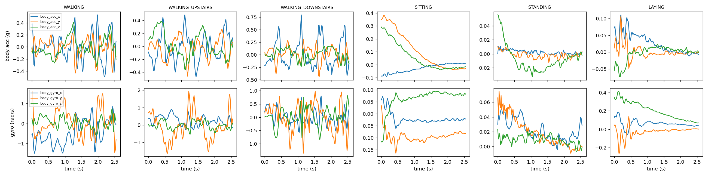
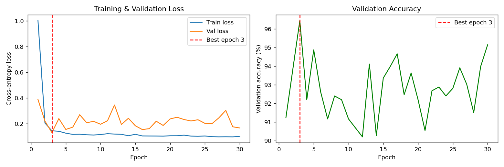
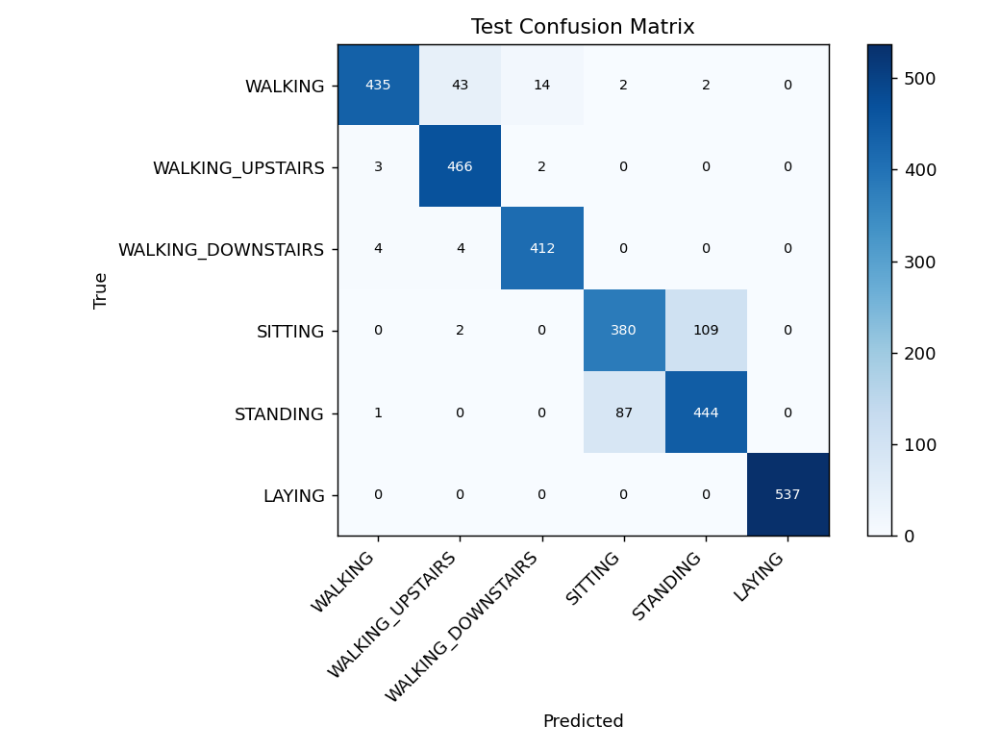
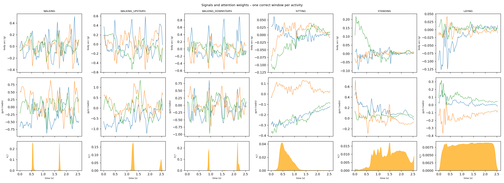
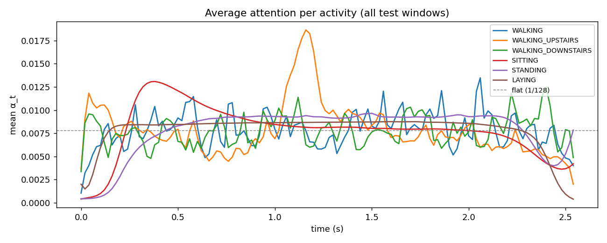

# Looking Where the Model Looks: Building a BiLSTM + Attention Network From Scratch for Human Activity Recognition

Every time your phone counts your steps, tracks a stair climb, or notices you have sat still for too long, it is solving a multivariate time-series classification problem. Beneath the polished fitness ring is a tiny stream of accelerometer and gyroscope readings sampled dozens of times per second.

In this project, we set out to recognise six human activities—**Walking**, **Walking Upstairs**, **Walking Downstairs**, **Sitting**, **Standing**, and **Laying**—directly from raw smartphone motion signals. Rather than calling `nn.LSTM` or `nn.MultiheadAttention`, we implemented every recurrent cell, bidirectional sequence loop, and temporal attention layer from scratch using only PyTorch tensors, `nn.Module`, `nn.Parameter`, and `nn.Linear`. Along the way, we answered a practical interpretability question: **which moments of a 2.56-second window does the network actually pay attention to, and which activities can it not tell apart?**

---

## 1. The Signals and Person-Based Split

We used the raw inertial signals from the **UCI Human Activity Recognition (HAR) Using Smartphones** dataset, recorded from 30 volunteers (aged 19–48) wearing a waist-mounted Samsung Galaxy S II at 50 Hz. Each window spans **128 time steps (2.56 seconds)** across **9 sensor channels**:

- **Body acceleration (`body_acc_x/y/z`, g):** dynamic linear acceleration with gravity removed.
- **Angular velocity (`body_gyro_x/y/z`, rad/s):** rotational rate around each axis.
- **Total acceleration (`total_acc_x/y/z`, g):** raw accelerometer reading including gravity.

Inspecting one example window per activity reveals an immediate split between moving and still behaviours. During `WALKING`, `WALKING_UPSTAIRS`, and `WALKING_DOWNSTAIRS`, both body acceleration and gyroscope signals oscillate strongly in a periodic gait rhythm. During `SITTING`, `STANDING`, and `LAYING`, both dynamic channels remain nearly flat near zero because the waist-worn phone undergoes almost no dynamic motion.

To avoid data leakage, we split validation data **by volunteer** rather than by random window (`VAL_SUBJECTS = [3, 15, 25, 30]`). Adjacent windows in this dataset overlap by 50% (sliding 64 samples at a time). A random window split would place overlapping halves of the same stride in both training and validation, inflating validation accuracy through memorisation. Splitting by person leaves **5,891 training windows** (17 volunteers), **1,461 validation windows** (4 volunteers), and **2,947 test windows** (9 unseen volunteers). Each channel is standardised using only the training mean and standard deviation.

---

## 2. Building RNN, LSTM, BiLSTM, and Attention From Scratch

Our final model, **HARNet** (46,982 trainable parameters), stacks a bidirectional LSTM with additive attention over time and a linear classification head.

1. **Packed LSTM Cell (`LSTMCell`):** Instead of four separate linear layers per gate, all four gates (input $i_t$, forget $f_t$, cell candidate $g_t$, output $o_t$) are packed into one weight matrix $W \in \mathbb{R}^{4H \times D}$, recurrent matrix $U \in \mathbb{R}^{4H \times H}$, and bias $b \in \mathbb{R}^{4H}$ with $H=64$, initialised uniformly in $[-1/\sqrt{H}, 1/\sqrt{H}]$. Splitting $Wx_t + Uh_{t-1} + b$ into four chunks of size $H$ gives:
   $$c_t = f_t \odot c_{t-1} + i_t \odot g_t, \qquad h_t = o_t \odot \tanh(c_t)$$
2. **Bidirectional LSTM (`BiLSTM`):** Two independent `LSTM` layers process the 128-step sequence—one forward ($x_1 \dots x_{128}$) and one backward ($x_{128} \dots x_1$). The backward outputs are reversed back into time order and concatenated with the forward states at each step, yielding $H_{\text{bi}} \in \mathbb{R}^{B \times 128 \times 128}$.
3. **Temporal Attention (`Attention`):** To let the model weigh informative instants instead of relying solely on the final step, we compute additive attention scores:
   $$e_t = v^\top \tanh(W_a h_t + b_a), \qquad \alpha_t = \frac{\exp(e_t)}{\sum_{s=1}^{128} \exp(e_s)}, \qquad c = \sum_{t=1}^{128} \alpha_t h_t$$
   Finally, `nn.Linear(128, 6)` maps the context vector $c$ to 6 class logits.

Why is a bidirectional LSTM allowed here? Because our system classifies a **complete, pre-recorded 2.56-second window** where all 128 samples are available at inference time. In a real-time streaming task—such as triggering an immediate fall alarm with zero look-ahead—the backward pass would require future samples that have not yet arrived, making BiLSTM invalid.

We also implemented a plain `RNNCell` ($h_t = \tanh(Wx_t + Uh_{t-1} + b)$) for comparison. Over 128 steps, plain RNN gradients repeatedly multiply by $\tanh$ Jacobians whose eigenvalues are $\le 1$, causing gradients to vanish exponentially. In contrast, the LSTM cell state $c_t = f_t \odot c_{t-1} + i_t \odot g_t$ provides an additive gradient highway whenever $f_t \approx 1$ and $i_t \approx 0$, preserving long-range information. Meanwhile, gradient clipping (`clip_grad_norm_` at total norm `1.0`) guards against the opposite failure—exploding gradients—by rescaling large gradient vectors before `Adam` steps.

---

## 3. Training and Evaluation Results

We trained HARNet for 30 epochs using cross-entropy loss, `Adam` ($\text{lr}=10^{-3}$), batch size 64, and gradient norm clipping at `1.0`. Before training, initial loss was **1.8058**—right next to the theoretical random baseline $\ln(6) \approx 1.7918$.

Because validation comes from only four volunteers, the validation curve is naturally noisy; the lowest validation loss (**0.1304**, **96.44%** validation accuracy) occurred at **Epoch 3**. Evaluating that checkpoint once on the 2,947 unseen test windows achieved **90.74% overall test accuracy**:

| Activity | Test Windows | Per-Class Accuracy | Mean max $\alpha_t$ |
|---|---:|---:|---:|
| `WALKING` | 496 | 87.70% | 0.2863 |
| `WALKING_UPSTAIRS` | 471 | 98.94% | 0.2174 |
| `WALKING_DOWNSTAIRS` | 420 | 98.10% | 0.2640 |
| `SITTING` | 491 | 77.39% | 0.0166 |
| `STANDING` | 532 | 83.46% | 0.0162 |
| `LAYING` | 537 | **100.00%** | 0.0104 |

Two patterns stand out immediately:

1. **Most confused pair (`SITTING` ↔ `STANDING`):** Nearly all errors come from mistaking `SITTING` as `STANDING` (109 windows) and `STANDING` as `SITTING` (87 windows). From a waist-mounted phone, both postures exhibit near-zero body acceleration and gyroscope rotation, differing only by subtle waist tilt in the gravity vector.
2. **Perfect recognition of `LAYING` (537 / 537 = 100.00%):** When lying down, gravity shifts onto a completely different axis of the phone's accelerometer (`total_acc_x/y/z`), creating a constant offset that separates `LAYING` cleanly from every upright activity.

---

## 4. Where Does the Model Look?

Plotting the attention weights $\alpha_t$ beneath the sensor waveforms answers our central question.

Attention is **dramatically more peaked for moving activities** (`mean max α_t` of **0.2863** for `WALKING`, **0.2640** for `WALKING_DOWNSTAIRS`, and **0.2174** for `WALKING_UPSTAIRS`) than for still activities (**0.0166** for `SITTING`, **0.0162** for `STANDING`, and **0.0104** for `LAYING`, barely above the uniform baseline $1/128 \approx 0.0078$).

In moving windows, the network locks onto one or two sharp step-impact instants where gait acceleration peaks—ignoring redundant portions of the cycle. In still windows, the signal is steady across all 2.56 seconds, so every time step carries roughly equal information and the model spreads its attention smoothly across the entire window.

To make these internal signals easy to explore, we also built a standalone browser application (`app/index.html`) that runs the exact 46,982-parameter BiLSTM + Attention forward pass in pure JavaScript with zero backend server. You can pick any test window or upload a $128 \times 9$ CSV to inspect the waveforms, class probabilities, and attention peaks interactively.
